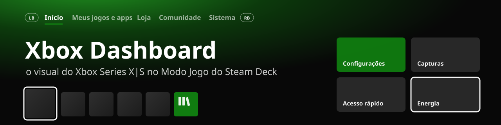
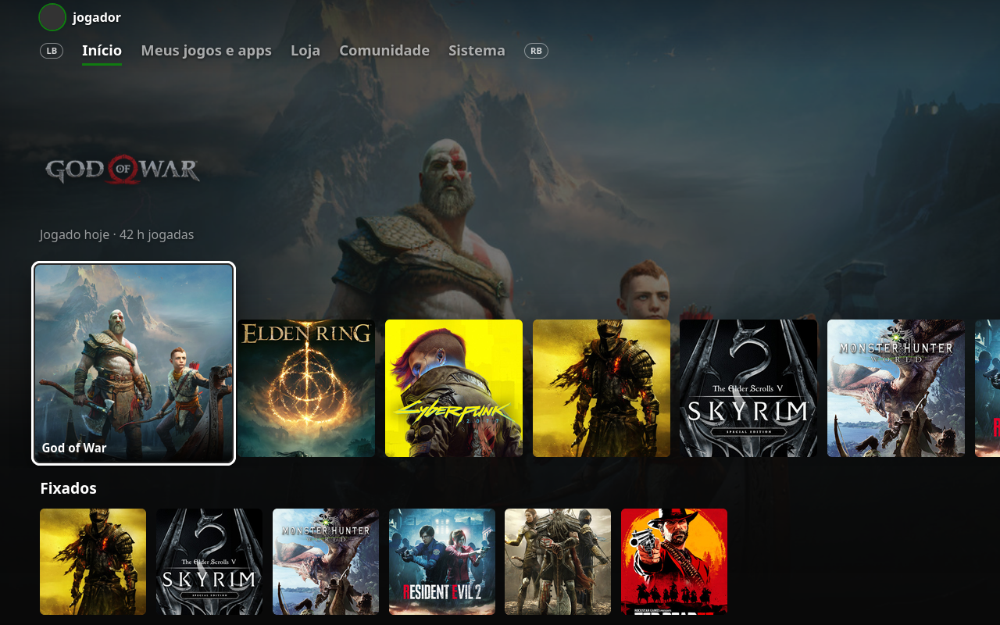
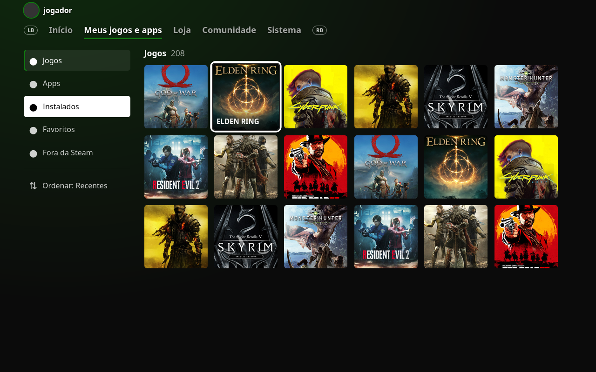
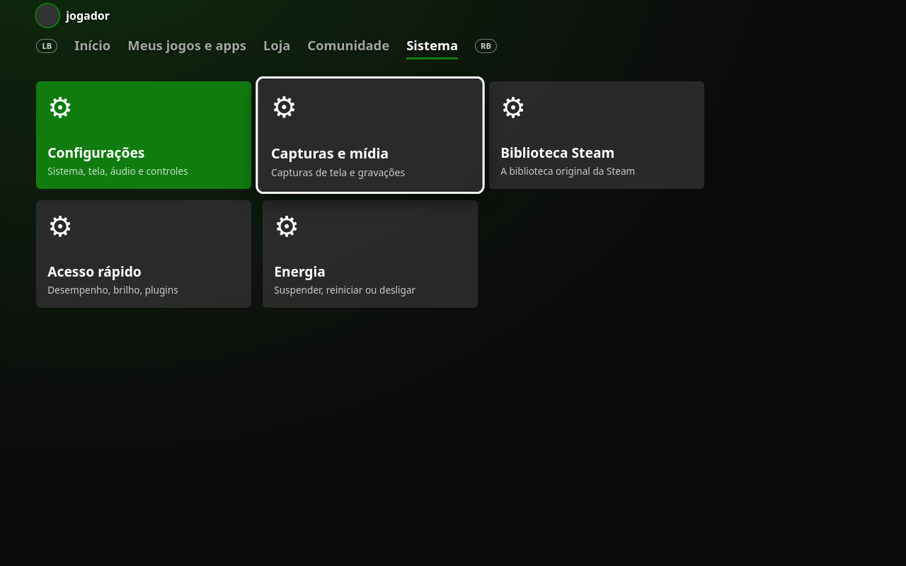

<p align="center">
  
</p>

<p align="center">
  <b>Plugin do <a href="https://github.com/SteamDeckHomebrew/decky-loader">Decky Loader</a> que transforma o Modo Jogo do SteamOS no dashboard do Xbox Series X|S.</b><br>
  Tela inicial com a arte do jogo em destaque, abas no topo com LB / RB, “Meus jogos e apps”, menus estilo Guia e as cores do Xbox em toda a Steam.
</p>

<p align="center">
  
  
  
  
  <a href="https://buymeacoffee.com/kromossomoc"></a>
</p>

---

## ✨ Prévia

<p align="center">
  
</p>

<table>
  <tr>
    <td width="50%"></td>
    <td width="50%"></td>
  </tr>
  <tr>
    <td align="center"><sub><b>Meus jogos e apps</b>: filtros na lateral, grade de blocos quadrados</sub></td>
    <td align="center"><sub><b>Sistema</b>: atalhos em cartões, como no Xbox</sub></td>
  </tr>
</table>

<sub>As imagens são prévias do layout, na resolução do Steam Deck (1280×800).</sub>

## 🎮 O que ele faz

| | |
|---|---|
| 🏠 **Tela inicial Xbox** | Substitui a tela inicial da Steam. A arte do jogo em foco ocupa a tela, com o logo e “Jogado hoje · 42 h jogadas”. O primeiro bloco dos recentes é maior, e no fim da fileira ficam **Meus jogos e apps** e **Loja**. Mais abaixo vêm **Fixados** (seus Favoritos), **Instalados** e **Atalhos**. Ao descer, a arte escurece, como no Xbox. |
| 🔀 **Abas com LB / RB** | **Início · Meus jogos e apps · Loja · Comunidade · Sistema** no topo da tela. LB e RB trocam de aba e **B** volta para o Início. |
| 📚 **Meus jogos e apps** | Grade de blocos quadrados com menu lateral: Jogos, Apps, Instalados, Favoritos, Fora da Steam e as suas coleções. Ordem por Recentes ou A–Z. |
| 🎨 **Cores do Xbox em tudo** | O azul da Steam vira a cor de destaque, e os cinzas azulados viram os cinzas neutros do Xbox, em menus, botões, interruptores e páginas, inclusive as que não são do plugin. |
| 🧭 **Menus estilo Guia** | O menu Steam e o Acesso Rápido ganham um painel escuro, uma faixa na cor de destaque e o item focado em branco com texto preto. |
| ⬜ **Foco do Series X\|S** | Borda branca com um espaço escuro em volta do bloco focado e cantos arredondados. |
| 🔤 **Fonte estilo Segoe** | Usa Segoe UI ou Selawik se estiverem instaladas, senão Noto Sans. |

### Controles

| Botão | Ação |
|---|---|
| **A** | Joga o jogo (ou abre a página dele, se não estiver instalado) |
| **≡** | Abre os detalhes do jogo |
| **LB / RB** | Aba anterior / próxima aba |
| **B** | Volta para o Início |

## 📦 Instalação

<p align="center">
  <a href="https://github.com/kromossomom-debug/decky-xbox-dashboard/raw/main/xbox-dashboard.zip">
    
  </a>
</p>

1. Baixe o **[xbox-dashboard.zip](https://github.com/kromossomom-debug/decky-xbox-dashboard/raw/main/xbox-dashboard.zip)** no Deck (ele vai para a pasta Downloads).
2. Abra o Acesso Rápido (`…`) → **Decky** → ⚙️ → **Geral** e ative o **Modo desenvolvedor**.
3. Em **Desenvolvedor → Instalar plugin a partir de ZIP**, escolha o arquivo nos Downloads. Pronto.

> Precisa do [Decky Loader](https://github.com/SteamDeckHomebrew/decky-loader) instalado.

## ⚙️ Configurações

Tudo fica no painel do plugin, no menu de Acesso Rápido. As escolhas são salvas em
`~/homebrew/settings/xbox-dashboard/settings.json`.

| Opção | Padrão | O que muda |
|---|---|---|
| Ativar visual Xbox | ligado | Liga ou desliga tudo de uma vez |
| Tela inicial Xbox | ligado | Usa a tela inicial do plugin no lugar da tela da Steam |
| Cores do Xbox em tudo | ligado | Repinta a Steam inteira com a paleta do Xbox |
| Cor de destaque | Verde Xbox | Verde Xbox, Verde Series X\|S, Verde-limão, Azul, Vermelho, Roxo, Laranja, Rosa ou Branco |
| Fundo da tela inicial | Arte do jogo | Arte do jogo, gradiente na cor de destaque ou escuro |
| Foco | Borda branca | Borda branca ou na cor de destaque |
| Arredondamento dos blocos | 6 px | De 0 a 16 px |
| Menus estilo Guia | ligado | Menu Steam e Acesso Rápido com cara de Guia |
| Tela inicial limpa | desligado | Esconde Novidades, Amigos e Recomendados (na tela da Steam) |
| Fonte estilo Segoe | ligado | Troca a fonte da interface |

> **Algo estranho?** Desligue **Cores do Xbox em tudo** ou **Tela inicial Xbox**: a Steam volta ao normal na hora, sem reiniciar.

## 🛠️ Como funciona

- **Sem nomes de classe fixos.** As classes CSS da Steam mudam a cada atualização. O plugin procura os módulos de classe pelo nome das chaves (`RecentGamesContainer`, `BasicGameCarouselItem`...) com `findClassModule` e monta o CSS na hora.
- **Telas próprias em React.** A rota `/library/home` da Steam é substituída pela tela do plugin com `routerHook.addPatch`, e “Meus jogos e apps” ganha uma rota própria. Se a tela do plugin der erro, a da Steam aparece no lugar.
- **Repintura sem peso.** Em vez de copiar o CSS da Steam, o plugin troca as cores direto nas folhas de estilo da própria Steam, uma única vez por folha. Ao desligar, as cores originais voltam.
- **Todas as janelas do Modo Jogo.** O tema vale para a janela principal, o Acesso Rápido e o menu Steam, e é reaplicado se a Steam recriar alguma delas.
- **Seus dados ficam no Deck.** Jogos, coleções e imagens vêm das bibliotecas internas da Steam. Nada é enviado para fora.

<details>
<summary><b>Estrutura do projeto</b></summary>

```
src/
├── index.tsx        # registro do plugin, painel do Acesso Rápido, rotas
├── Shell.tsx        # barra de abas (LB/RB) e abas Loja, Comunidade e Sistema
├── XboxHome.tsx     # tela inicial: arte, recentes, fixados, instalados, atalhos
├── MyGames.tsx      # Meus jogos e apps
├── components.tsx   # blocos, cartões, fileiras e foco
├── steam.ts         # biblioteca, imagens, abrir jogos, rotas da Steam
├── theme.ts         # CSS do tema para as telas da Steam
├── palette.ts       # repintura com as cores do Xbox
├── injector.ts      # coloca o tema nas janelas do Modo Jogo
├── classes.ts       # descobre as classes CSS atuais da Steam
├── settings.ts      # opções e valores padrão
└── styles.ts        # CSS das telas do plugin
main.py              # salva as configurações
```

</details>

## 🧑‍💻 Desenvolvimento

```bash
npm install
npm run build        # gera dist/index.js
```

## ☕ Apoie o projeto

Se o plugin deixou o seu Deck com cara de Xbox e você quiser agradecer, pague um café para o autor.
Ajuda a manter o projeto atualizado quando a Steam muda.

<p align="center">
  <a href="https://buymeacoffee.com/kromossomoc">
    
  </a>
</p>

Também dá para abrir a página direto do Deck: painel do plugin → **Apoie o projeto → Buy Me a Coffee**.

## ⚠️ Aviso

Projeto de fã, sem relação com a Microsoft, o Xbox ou a Valve. “Xbox” e “Xbox Series X|S” são marcas da Microsoft.
“Steam” e “Steam Deck” são marcas da Valve. Este plugin só muda a aparência da interface no seu próprio aparelho.

## 📄 Licença

[MIT](LICENSE)
