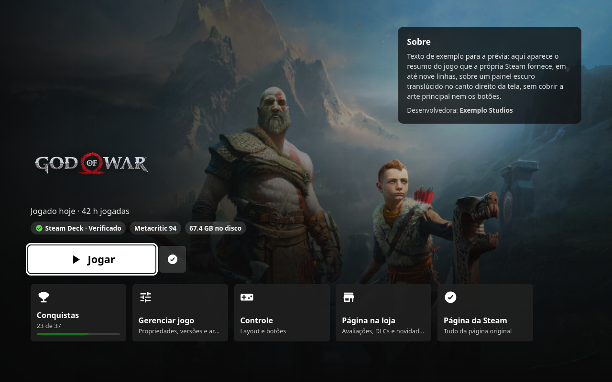

<p align="center">
  
</p>

<p align="center">
  <b>A <a href="https://github.com/SteamDeckHomebrew/decky-loader">Decky Loader</a> plugin that turns SteamOS Game Mode into the Xbox Series X|S dashboard.</b><br>
  A home screen built around the game's art, LB / RB tabs on top, “My games & apps”, Guide-style menus and Xbox colors across all of Steam.
</p>

<p align="center">
  
  
  
  
  <a href="https://buymeacoffee.com/kromossomoc"></a>
</p>

---

## ✨ Preview

<p align="center">
  
</p>

<table>
  <tr>
    <td width="50%"></td>
    <td width="50%"></td>
  </tr>
  <tr>
    <td align="center"><sub><b>My games & apps</b>: filters on the side, square tile grid</sub></td>
    <td align="center"><sub><b>System</b>: shortcuts as cards, like on Xbox</sub></td>
  </tr>
</table>

<p align="center">
  
  <br><sub><b>Game page</b> (press <b>Y</b> on any tile): Play, pin, Deck compatibility, HowLongToBeat, achievements and shortcuts</sub>
</p>

<sub>Layout previews at the Steam Deck's resolution (1280×800), shown with Steam in Portuguese.</sub>

## 📦 Install

<p align="center">
  <a href="https://github.com/kromossomom-debug/decky-xbox-dashboard/raw/main/xbox-dashboard.zip">
    
  </a>
</p>

1. Download **[xbox-dashboard.zip](https://github.com/kromossomom-debug/decky-xbox-dashboard/raw/main/xbox-dashboard.zip)** on your Deck (it goes to your Downloads folder).
2. Open Quick Access (`…`) → **Decky** → ⚙️ → **General** and turn on **Developer mode**.
3. Under **Developer → Install Plugin from ZIP**, pick the file from Downloads. Done.

> Requires [Decky Loader](https://github.com/SteamDeckHomebrew/decky-loader).

## 🎮 Features

| | |
|---|---|
| 🏠 **Xbox home screen** | Replaces Steam's home. The focused game's art fills the screen, with its logo and “Played today · 42 h played”. The first recent tile is larger, and the row ends with **My games & apps** and **Store**. Below come **Pinned** (your Favorites), **Installed** and **Shortcuts**. Scrolling down dims the art, just like on Xbox. |
| 🔀 **LB / RB tabs** | **Home · My games & apps · Store · Community · System** across the top. LB and RB switch tabs, **B** goes back to Home. |
| 🎯 **Game page** | Press **Y** on any tile for an Xbox-style game hub: full-screen art, logo, a big **Play** button (or **Install** / **Resume**), Steam Deck compatibility, Metacritic and size badges, an About panel, and cards for Achievements (with progress), Manage game, Controller, Store page and Steam's own page. |
| ⏱️ **HowLongToBeat** | Main story, main + extras and completionist times on the game page, with how far your playtime is into the story, and “≈ 20 h to beat” next to the focused game on Home. Looked up only when you look at a game and cached for a week. |
| 📌 **Pin to Home** | Press **X** on any tile (or the pin button on the game page) to pin or unpin it. Pinned games fill the **Pinned** row; until you pin something, your Steam Favorites stand in. |
| 🧱 **Your own Home rows** | Turn Pinned, Installed and Shortcuts on or off, and add one of your Steam collections as an extra row. |
| 📚 **My games & apps** | A square tile grid with a side menu: Games, Apps, Installed, Favorites, Non-Steam and your own collections. Sort by Recent or A–Z. |
| 🎨 **Xbox colors everywhere** | Steam's blue becomes the accent color and its bluish greys become Xbox's neutral greys, in menus, buttons, toggles and pages, including the ones the plugin doesn't draw. |
| 🧭 **Guide-style menus** | The Steam menu, Quick Access and the power menu get a dark panel with an accent glow, an accent stripe and the focused item in white with black text (red for Shut down and other destructive actions). |
| ✨ **Menu effects** | Light animations: Steam menu items slide in one after another, the power menu pops in, Quick Access panels fade up. Transform and opacity only, so they stay smooth, and they follow the system's reduce-motion setting. |
| ⬜ **Series X\|S focus** | A white ring with a dark gap around the focused tile, and rounded corners. |
| 🔤 **Segoe-style font** | Uses Segoe UI or Selawik when installed, otherwise Noto Sans. |
| 🌐 **English & Portuguese** | Follows Steam's language: Portuguese when Steam is in Portuguese, English otherwise. |

### Controls

| Button | Action |
|---|---|
| **A** | Play the game (or open its page if it isn't installed) |
| **Y** | Open the game page |
| **X** | Pin to / unpin from Home |
| **LB / RB** | Previous / next tab |
| **B** | Back to Home |

## ⚙️ Settings

Everything lives in the plugin's panel in Quick Access. Your choices are saved to
`~/homebrew/settings/xbox-dashboard/settings.json`.

| Option | Default | What it does |
|---|---|---|
| Enable Xbox look | on | Turns everything on or off at once |
| Xbox home screen | on | Uses the plugin's home screen instead of Steam's |
| Xbox colors everywhere | on | Repaints all of Steam with the Xbox palette |
| Accent color | Xbox green | Xbox green, Series X\|S green, lime, blue, red, purple, orange, pink or white |
| Home background | Game art | Game art, an accent-color gradient or dark |
| Focus | White ring | White ring or accent-color ring |
| Tile corner radius | 6 px | 0 to 16 px |
| Xbox Guide-style menus | on | Guide-style Steam menu, Quick Access and power menu |
| Menu effects | on | Light animations in those menus |
| Clean home screen | off | Hides What's New, Friends and Recommended (on Steam's home) |
| Segoe-style font | on | Swaps the interface font |
| Time to beat (HowLongToBeat) | on | Shows HowLongToBeat times on the game page and Home |
| Home rows | Pinned, Installed, Shortcuts | Which rows Home shows, plus one extra collection |

> **Something looks off?** Turn off **Xbox colors everywhere** or **Xbox home screen**: Steam goes back to normal right away, no restart needed.

## 🛠️ How it works

- **No hard-coded class names.** Steam's CSS class names change with every update. The plugin finds class modules by their key names (`RecentGamesContainer`, `BasicGameCarouselItem`...) with `findClassModule` and builds its CSS at runtime.
- **Its own React screens.** Steam's `/library/home` route is swapped for the plugin's screen with `routerHook.addPatch`, and “My games & apps” gets a route of its own. If the plugin's screen ever crashes, Steam's shows up instead.
- **Lightweight repaint.** Instead of copying Steam's CSS, the plugin swaps colors directly in Steam's own stylesheets, once per sheet. Turning it off puts the original colors back.
- **Every Game Mode window.** The theme covers the main window, Quick Access and the Steam menu, and is reapplied if Steam recreates any of them.
- **Your data stays on the Deck.** Games, collections and images come from Steam's internal stores. The only outside request is the HowLongToBeat lookup (just the game's name), which you can turn off.
- **Big libraries stay quick.** “My games & apps” draws tiles in batches as you scroll instead of all at once.

<details>
<summary><b>Project layout</b></summary>

```
src/
├── index.tsx        # plugin entry, Quick Access panel, routes
├── Shell.tsx        # tab bar (LB/RB) and the Store, Community and System tabs
├── XboxHome.tsx     # home: art, recent, pinned, installed, shortcuts
├── MyGames.tsx      # My games & apps
├── GamePage.tsx     # game page (Play, badges, achievements, shortcuts)
├── components.tsx   # tiles, cards, rows and focus handling
├── steam.ts         # library, images, launching games, Steam routes
├── theme.ts         # theme CSS for Steam's own screens
├── palette.ts       # Xbox color repaint
├── injector.ts      # puts the theme into Game Mode windows
├── classes.ts       # finds Steam's current CSS class names
├── settings.ts      # options and defaults
├── store.ts         # live settings, pins
├── hltb.ts          # HowLongToBeat on the frontend
├── i18n.ts          # English and Portuguese text
└── styles.ts        # CSS for the plugin's screens
main.py              # saves settings, HowLongToBeat lookups
py_modules/
└── hltb_client.py   # HowLongToBeat search with a week-long cache
```

</details>

## 🧑‍💻 Development

```bash
npm install
npm run build        # outputs dist/index.js
npm run package      # build + xbox-dashboard.zip
```

Every push is built by GitHub Actions. Pushing a tag such as `v0.0.3-alpha` publishes a release with the ZIP attached.

## ☕ Support the project

If the plugin gave your Deck an Xbox makeover and you'd like to say thanks, buy the author a coffee.
It helps keep the project updated when Steam changes.

<p align="center">
  <a href="https://buymeacoffee.com/kromossomoc">
    
  </a>
</p>

You can also open the page right from the Deck: plugin panel → **Support the project → Buy Me a Coffee**.

## ⚠️ Disclaimer

A fan project, not affiliated with Microsoft, Xbox or Valve. “Xbox” and “Xbox Series X|S” are trademarks of Microsoft.
“Steam” and “Steam Deck” are trademarks of Valve. This plugin only changes how the interface looks on your own device.

## 📄 License

[MIT](LICENSE)
